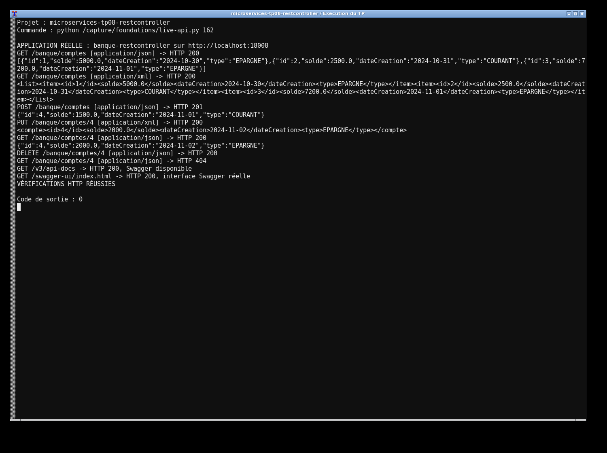
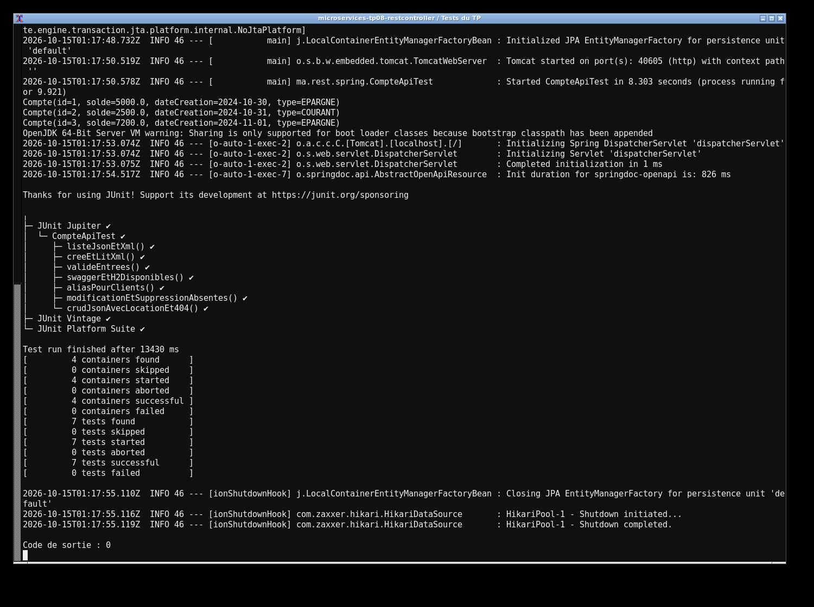

# TP8 — API bancaire avec RestController

J'ai créé l'API bancaire avec Spring MVC, JPA et une base H2 en mémoire. `Compte` contient l'identifiant, le solde, la date et le type, enregistré en texte. Trois comptes sont ajoutés au démarrage. Les routes `/banque/comptes` permettent la consultation, l'ajout, la modification et la suppression.

J'utilise Java 17 et Maven. Pour lancer le projet :

```sh
mvn clean verify
mvn spring-boot:run
```

L'application écoute sur le port 8082. Swagger est accessible à `http://localhost:8082/swagger-ui.html` et la console H2 à `/h2-console` (URL JDBC `jdbc:h2:mem:banque`, utilisateur `sa`, mot de passe vide). Les mêmes routes sont aussi disponibles sous `/api` pour les clients du cours. JSON et XML sont choisis par les en-têtes HTTP. La création renvoie 201 avec `Location`, les ressources absentes 404 et les données invalides 400.

Les captures montrent l'exécution réelle du projet et des tests sur ma machine.



